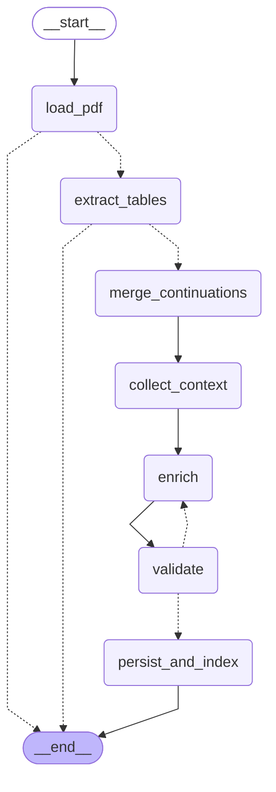
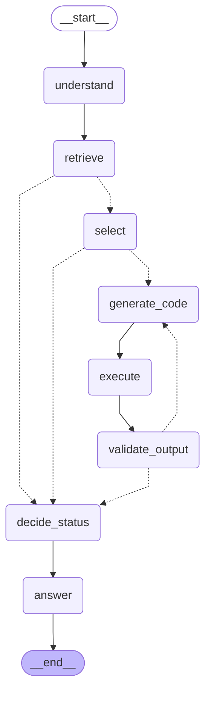

# QA multiagente sobre tablas en PDFs

Sistema de dos agentes que responde preguntas en lenguaje natural sobre las **tablas** de informes en PDF. Las respuestas se **calculan con código Python** sobre los datos extraídos, usan solo lo que está en las tablas y dicen explícitamente cuándo una pregunta no se puede responder, total o parcialmente.

- **Agente de Ingesta**: lee un PDF, encuentra sus tablas, las limpia, las documenta con un LLM (nombre, descripción, unidades de cada columna…), las guarda localmente y las indexa en Pinecone.
- **Agente Analista**: entiende la pregunta, busca las tablas relevantes, decide si los datos alcanzan, genera un programa en Python, lo ejecuta aislado, se corrige si falla y responde con estado `answered`, `partial` o `cannot_answer`.

Todo se usa desde una app de Streamlit con tres pestañas (**Subir PDF**, **Explorar**, **Preguntar**) y cada ejecución queda trazada en LangSmith.

**Resultados de la evaluación:** 16/16 preguntas correctas sobre un PDF sintético y uno real de INDEC. Detalle, trazas y análisis en [EVALUATION.md](EVALUATION.md). Arquitectura y contratos internos en [docs/ARCHITECTURE.md](docs/ARCHITECTURE.md).

---

## Contenido

1. [Instalación](#instalación)
2. [Uso](#uso)
3. [Cómo funciona](#cómo-funciona)
4. [Decisiones de diseño](#decisiones-de-diseño)
5. [Evaluación](#evaluación)
6. [Limitaciones conocidas](#limitaciones-conocidas)
7. [Solución de problemas](#solución-de-problemas)
8. [Estructura del repositorio](#estructura-del-repositorio)
9. [Créditos](#créditos)

---

## Instalación

### Requisitos

- [uv](https://docs.astral.sh/uv/) (gestiona Python ≥ 3.11 y las dependencias; si no tenés Python, uv lo descarga).
- Credenciales de tres servicios: el **proxy LiteLLM** de la cátedra, **Pinecone** (plan gratuito alcanza) y **LangSmith**.
- **Docker** (opcional, recomendado): el código que genera el Analista corre en un contenedor sin red. Sin Docker se usa un subproceso con aislamiento parcial (ver [Sandbox](#el-código-generado-corre-aislado)).

### 1. Instalar uv

Windows (PowerShell):
```powershell
powershell -ExecutionPolicy ByPass -c "irm https://astral.sh/uv/install.ps1 | iex"
```
macOS / Linux / WSL:
```bash
curl -LsSf https://astral.sh/uv/install.sh | sh
```

### 2. Clonar e instalar dependencias

```bash
git clone <url-del-repo> tp1-multiagentes
cd tp1-multiagentes
uv sync
```

`uv sync` crea `.venv/` con las versiones exactas de `uv.lock`.

### 3. Configurar el `.env`

Copiá `.env.example` como `.env` (en la raíz del repo) y completá las claves. **El `.env` nunca se sube al repositorio** (ya está en `.gitignore`).

| Variable | Obligatoria | Valor de ejemplo / descripción |
|---|---|---|
| `LITELLM_BASE_URL`, `LITELLM_API_KEY` | sí | URL y clave del proxy LiteLLM |
| `LLM_MODEL` | sí | `gpt-4.1-mini` |
| `EMBEDDING_MODEL`, `EMBEDDING_DIM` | sí | `text-embedding-3-small`, `1536` |
| `LLM_STRUCTURED_METHOD` | no | `function_calling` (también `json_schema` o `json_mode`) |
| `LLM_CODE_MODEL` | no | otro modelo solo para generar código; vacío = `LLM_MODEL` |
| `PINECONE_API_KEY` | sí | clave de Pinecone |
| `PINECONE_INDEX_NAME` | sí | `mas-2026s2-tables` (se crea solo si no existe) |
| `PINECONE_CLOUD`, `PINECONE_REGION` | no | `aws`, `us-east-1` (lo que admite el plan gratuito) |
| `LANGSMITH_API_KEY`, `LANGSMITH_PROJECT` | sí | clave y nombre del proyecto de trazas |
| `LANGSMITH_TRACING` | no | `true` |
| `SANDBOX_BACKEND` | no | `auto` (Docker si está, si no subproceso), `docker` o `subprocess` |
| `SANDBOX_TIMEOUT_S`, `SANDBOX_IMAGE` | no | `30`, `mas-tp-sandbox` |
| `INGEST_MAX_RETRIES`, `ANALYST_MAX_RETRIES`, `RETRIEVAL_K` | no | `2`, `3`, `6` |
| `LLM_CACHE` | no | `true`: guarda respuestas del LLM y embeddings en `.cache/` para no gastar presupuesto al repetir |
| `DATA_DIR` | no | `data/store` (tablas ingeridas) |

Verificá la conexión con los servicios:
```bash
uv run python scripts/check_services.py
```
Prueba el `.env`, el proxy (chat, los tres métodos de salida estructurada y embeddings), Pinecone y LangSmith, y muestra PASS/FAIL para cada uno.

### 4. Construir la imagen del sandbox (opcional)

```bash
docker build -t mas-tp-sandbox sandbox/
```

### 5. Correr los tests

```bash
uv run pytest -q               # no usan red ni claves: los servicios externos están simulados
uv run pytest -m docker -q     # tests del sandbox en Docker (necesitan la imagen)
```

---

## Uso

### App de Streamlit

```bash
uv run streamlit run app.py
```
Se abre en http://localhost:8501.

1. **Subir PDF**: elegí un PDF y tocá *Ingerir*. Se ve el progreso paso a paso y, al terminar, cada tabla indexada con su nombre, descripción, columnas, filas, primeras 5 filas y páginas, más los avisos (imágenes que podrían ser tablas, tablas descartadas, etc.). Los PDF de ejemplo están en `data/sample_pdfs/`.
2. **Explorar**: todas las tablas guardadas, agrupadas por PDF, con sus datos completos y la descripción de cada columna.
3. **Preguntar**: escribí una pregunta o elegí una del desplegable de ejemplos. Cada respuesta muestra el estado (verde: respondida, naranja: parcial, rojo: no se puede responder), lo que falta, las tablas usadas, el código generado, la salida de la ejecución y los reintentos.

La barra lateral muestra la configuración activa (modelos, índice, sandbox, trazas) sin claves. Si falta alguna variable obligatoria, las pestañas que la necesitan quedan bloqueadas y se indica cuál falta; si falla un servicio, aparece un error que lo nombra y la app sigue funcionando.

### Línea de comandos

```bash
# Ingerir uno o varios PDF
uv run python -m agents.ingestion.cli data/sample_pdfs/informe_sintetico.pdf data/sample_pdfs/indec_ica.pdf

# Preguntar
uv run python -m agents.analyst.cli "¿Cuál fue el total de exportaciones de la provincia en 2023, en millones de dólares?"
uv run python -m agents.analyst.cli --id syn-04          # una pregunta del set de evaluación
uv run python -m agents.analyst.cli --doc indec_ica.pdf  # todas las de un PDF, con resumen esperado vs. obtenido

# Ver qué tablas detecta la extracción en un PDF (sin LLM)
uv run python -m agents.ingestion.extract data/sample_pdfs/indec_ica.pdf
```

> En Windows, si redirigís la salida a un archivo (`> salida.txt`), usá `uv run python -X utf8 -m …` para evitar errores de codificación.

### Evaluación

```bash
uv run python -m eval.run_local       # escribe EVALUATION.md y eval/last_run.json
uv run python -m eval.run_langsmith   # dataset + experimento en LangSmith
```

Para publicar una traza con link público (se abre sin cuenta de LangSmith):
```bash
uv run python scripts/share_trace.py --pdf data/sample_pdfs/indec_ica.pdf   # traza de una ingesta
uv run python scripts/share_trace.py --id syn-10                            # traza de una pregunta
```
Los PDF de las preguntas tienen que estar ingeridos en la misma PC (el script avisa si falta alguno).

---

## Cómo funciona

### Agente de Ingesta



| Nodo | Qué hace |
|---|---|
| `load_pdf` | Abre el PDF y lee el texto y los bloques de cada página con sus coordenadas. Corta con un mensaje claro si el archivo no es un PDF válido, está protegido o no tiene capa de texto. |
| `extract_tables` | Detecta tablas con PyMuPDF (grillas) y con un detector propio de tablas de solo líneas horizontales. Aplana encabezados de varios niveles (`Exportaciones \| 2026 \| Millones de USD`), convierte números con formato argentino o inglés, porcentajes, monedas y negativos entre paréntesis, y marca faltantes (`s/d`, `…`, `-` según el documento). Avisa las imágenes grandes que podrían ser tablas. Si no hay tablas, termina sin llamar al LLM. |
| `merge_continuations` | Une una tabla que sigue en la página siguiente (misma cantidad de columnas, sin epígrafe nuevo ni "Fuente" en el medio). |
| `collect_context` | Junta el epígrafe ("Cuadro N…"), el título de sección, los párrafos antes y después y las notas al pie. |
| `enrich` | Una llamada al LLM por tabla, en paralelo, con salida estructurada: nombre, descripción, y por columna unidad, escala y tipo de valor (nominal, real, porcentaje…), más períodos y entidades. |
| `validate` | Reglas fijas: una descripción por cada columna con su nombre exacto, columna de encabezados de fila válida (los encabezados los completa el sistema, no el LLM), nombre no genérico, descripción de 2 a 4 oraciones, unidad en toda columna numérica (puede ser "desconocida") y "nominal/real" solo si el documento lo dice. Las tablas inválidas vuelven a `enrich` con los errores, hasta `INGEST_MAX_RETRIES`; si siguen mal se saltean con un aviso. |
| `persist_and_index` | Guarda cada tabla en Parquet + JSON, guarda una copia del PDF y hace upsert de un vector por tabla en Pinecone. Re-ingerir el mismo PDF reemplaza lo anterior (sin duplicados). |

### Agente Analista



| Nodo | Qué hace |
|---|---|
| `understand` | El LLM divide la pregunta en subpreguntas calculables, con sus métricas, entidades, períodos y operación, y propone de 1 a 4 búsquedas. |
| `retrieve` | Embebe cada búsqueda, consulta Pinecone y une los resultados sin duplicados. Si el índice está vacío, va directo a `decide_status`. |
| `select` | El LLM decide qué tablas responden cada subpregunta y si los datos alcanzan. Después, chequeos fijos pueden **quitar** cobertura (nunca agregarla): período o entidad que no están en las tablas, unidad dudosa cuando la pregunta depende de ella, y un valor de comparación ("promedio provincial") que ninguna tabla informa. Si nada queda cubierto, no se genera código. |
| `generate_code` | El LLM escribe un programa pandas que carga las tablas con `load_table("<table_id>")` e imprime un JSON con los resultados. Recibe solo las subpreguntas cubiertas y, aparte, las que **no** tiene que calcular. |
| `execute` | Corre el programa en el sandbox (Docker o subproceso) con solo las tablas elegidas. |
| `validate_output` | Verifica que terminó bien, que la última línea es un JSON válido, sin `NaN` y con todas las subpreguntas. Si no, vuelve a `generate_code` con el error, hasta `ANALYST_MAX_RETRIES` reintentos. |
| `decide_status` | Reglas fijas: `answered` si se resolvieron todas las subpreguntas, `partial` si algunas, `cannot_answer` si ninguna o si el código falló en todos los intentos. |
| `answer` | Para `answered`/`partial`, el LLM redacta la respuesta con los números ya formateados (formato argentino), las tablas, las páginas y el cálculo. Para `cannot_answer`, el texto sale de una plantilla sin LLM y sin números calculados. |

### Trazas

Cada ingesta aparece en LangSmith como `ingest:<nombre del PDF>` y cada pregunta como `analyst:<pregunta>`, con un span por nodo y por llamada al LLM, y metadatos con el modelo, el backend del sandbox y el `question_id` cuando la pregunta viene del set de evaluación.

---

## Decisiones de diseño

### Extracción
- **La extracción usa PyMuPDF y reglas propias, sin LLM**, porque una sola librería da tablas, texto con coordenadas y tamaños de letra (para títulos de sección), sin Java ni modelos pesados, y porque las reglas se pueden testear contra un PDF con verdad conocida. El LLM solo describe tablas ya extraídas.
- **Hay un detector propio para tablas con solo líneas horizontales** porque la estrategia de grilla de PyMuPDF no las ve y su estrategia por texto toma páginas enteras de INDEC como tabla. El detector separa columnas por los "ríos" de espacio en blanco de los datos (los encabezados suelen estar alineados distinto que los números) y solo acepta regiones con al menos una columna numérica, así las infografías no pasan.
- **Los encabezados se detectan y aplanan con `" | "`** (`Exportaciones | 2026 | Millones de USD`) porque los cuadros reales tienen hasta cuatro filas de encabezado con celdas combinadas; el nombre aplanado conserva el año y la unidad dentro de la columna.
- **El guion `-` vale cero o faltante según el documento**: si el PDF declara "- Cero absoluto" (como INDEC), es 0; si no, es faltante. El formato decimal se decide por columna (el que convierte más celdas) y, si empata, por el formato mayoritario del documento. La convención aplicada queda en las notas de la tabla, que leen el LLM y el código.
- **Las detecciones dudosas se descartan con umbrales simples**: menos de 2 filas de datos o 2 columnas, o menos de la mitad de las celdas con texto (los cuadros de INDEC superan el 57 %; sus gráficos no llegan al 40 %). Una columna se considera numérica si convierte al menos el 80 % de sus celdas.
- **Dos tablas no se unen si hay un epígrafe nuevo o una "Fuente" entre ellas**, aunque tengan las mismas columnas: así los Cuadros 9 y 10 de INDEC (consecutivos y con igual estructura) quedan separados.

### Ingesta
- **Las tablas viajan en el estado del grafo como JSON** (listas de valores con sus tipos), no como DataFrames, para que el estado sea serializable y se vea completo en las trazas.
- **Una llamada al LLM por tabla, en paralelo**, y las que fallan la validación se reintentan solas con los errores en el prompt. Si todas las llamadas fallan por el servicio (clave inválida, proxy caído), la ingesta se corta con ese error en lugar de reintentar como si fueran metadatos inválidos.
- **"Nominal" o "real" solo con respaldo del texto**: el LLM tiende a suponer "pesos corrientes"; una regla verifica que el documento lo diga, porque esa distinción decide si después se puede responder una pregunta sobre valores reales.
- **El almacén es Parquet + JSON, un archivo por tabla**: Parquet conserva los tipos, el JSON es legible y un archivo por tabla permite montar en el sandbox solo las tablas elegidas. También se guarda una copia del PDF.
- **Un vector por tabla en Pinecone**, con nombre, descripción, columnas, encabezados de fila, períodos, entidades y sección, porque las preguntas apuntan a una tabla por su tema y así la recuperación es fácil de explicar. Los metadatos llevan una vista previa recortada al límite de tamaño de Pinecone.
- **Re-ingerir un PDF reemplaza todo lo anterior de ese documento**: el id del documento es un hash del contenido, así que el mismo PDF con otro nombre no se duplica. Antes de borrar se calculan los embeddings y se verifica la dimensión del índice, para no dejar el documento a medias si algo falla.

### Analista
- **El estado de la respuesta lo deciden reglas, no el LLM**: una subpregunta está resuelta solo si está cubierta y el código devolvió un valor para ella. Es testeable y evita que el redactor "suavice" un `cannot_answer`.
- **Los chequeos de cobertura solo pueden quitar cobertura** y se basan en lo que se puede verificar: años y meses (por separado, porque en los cuadros reales el mes es una fila y el año una columna), nombres propios (se ignoran palabras de alcance como "provincia"), unidades desconocidas solo cuando cambian el resultado, y valores de comparación que ninguna tabla informa. Complementan al LLM, que tiende a dar por cubierto lo que no está.
- **El código no recibe la pregunta original**, solo las subpreguntas cubiertas y la lista de las que no tiene que calcular: con la pregunta completa, el modelo calculaba igual las partes sin datos.
- **Si el código falla, se reintenta con el error** (hasta 3 veces); si se agotan los intentos, la respuesta es `cannot_answer` con el motivo "falló el código", distinto de "faltan datos".
- **Los números se formatean en el sistema** (formato argentino: `1.234,56`) y el LLM redactor tiene que copiarlos tal cual, así no hace cuentas ni redondea por su cuenta.
- **`LLM_CODE_MODEL` permite usar otro modelo solo para el código**, por si el modelo por defecto genera programas con errores seguido.

### El código generado corre aislado
- **Docker por defecto, subproceso si Docker no está**: en Windows un subproceso no puede bloquear la red ni el sistema de archivos; un contenedor sí (`--network none`, raíz de solo lectura, 512 MB, 1 CPU, 64 procesos, usuario sin privilegios, solo las tablas elegidas montadas en modo lectura). El subproceso permite corregir sin Docker: corre con `python -I`, sin variables de entorno (sin claves), en un directorio temporal con solo las tablas elegidas, con la red bloqueada desde adentro y con timeout.
- **Un filtro estático revisa el código antes de ejecutarlo**, en ambos casos: solo permite importar `pandas`, `numpy`, `math`, `json`, `statistics`, `datetime`, `re`, `decimal` y `fractions`, y rechaza `eval`, `exec`, `open`, `getattr`, `exit`, atributos `__dunder__`, lectura o escritura de archivos con pandas y URLs.
- **El programa carga las tablas por id** (`load_table("…")`), sin rutas: un preludio fijo prepara el entorno y ejecuta el programa generado, así los errores señalan líneas del programa y el modelo puede corregirlas.

### Servicios y configuración
- **Los modelos por defecto son `gpt-4.1-mini` y `text-embedding-3-small` (1536 dimensiones)**: entre los del proxy, son baratos por llamada, aceptan temperatura 0 y salida estructurada; para textos cortos de metadatos un embedding más grande no mostraba beneficio. Cambiar el modelo de embeddings obliga a crear otro índice y volver a ingerir.
- **Todo acceso al LLM pasa por un único módulo** que apunta al proxy, aplica el método de salida estructurada configurado (`LLM_STRUCTURED_METHOD`, porque no todos los modelos del proxy soportan los mismos) y una caché propia en SQLite de respuestas y embeddings, en lugar de la de `langchain-community`, que está siendo discontinuada.
- **La dimensión de los embeddings se verifica** contra `EMBEDDING_DIM` y contra el índice existente antes de escribir nada.
- **La UI llama a los servicios a través de un módulo intermedio** (`ui/runtime.py`) para poder testear la app completa con servicios simulados, y clasifica cada error por el servicio que lo causó (LiteLLM, Pinecone, sandbox, configuración).

---

## Evaluación

`eval/questions.yaml` tiene 16 preguntas con estado y valores esperados: 11 sobre `informe_sintetico.pdf` (un anuario ficticio generado por `scripts/make_sample_pdf.py` con casos difíciles a propósito: tabla multipágina, encabezado de dos niveles, una tabla que no cubre el último año, desempleo por departamento sin promedio provincial, salarios sin aclarar si son nominales o reales) y 5 sobre `indec_ica.pdf` (Intercambio comercial argentino de INDEC, cifras de agosto de 2026). Cubren respuestas de una y de varias tablas, conversiones de escala, períodos y entidades faltantes, conversiones que requieren datos externos, un valor de comparación inexistente y preguntas sin ninguna tabla relacionada.

Una respuesta es correcta si el estado coincide y cada valor esperado aparece en los resultados del código con tolerancia relativa de 0,5 % (absoluta de 0,01 si el esperado es 0). Resultado actual: **16/16**. El reporte completo, las trazas representativas y un análisis de cómo se llegó a ese número (y de qué no mide) están en [EVALUATION.md](EVALUATION.md). Los valores esperados del PDF sintético se verifican en los tests contra los datos que generaron el PDF, y los de INDEC contra las tablas extraídas.

En LangSmith, `eval.run_langsmith` crea el dataset `mas-tp-tablas-preguntas` y corre un experimento con evaluadores automáticos de estado, valores y corrección, más la exactitud del experimento.

---

## Limitaciones conocidas

- **Solo PDFs con texto.** Los escaneados no se procesan (no hay OCR) y las tablas que son imágenes se saltean con un aviso.
- **Extracción imperfecta en tablas complejas.** En el Cuadro 3 de INDEC (pág. 13) PyMuPDF junta dos columnas en una celda (`-3,1 8.883`) y corta algunos encabezados; el detector de líneas horizontales supone que cada columna tiene datos alineados; la tabla de diagnósticos de la pág. 35 no tiene epígrafe, y los títulos de sección con la misma letra que el cuerpo no se detectan. La portada de INDEC genera un aviso de "posible tabla como imagen" que es un falso positivo.
- **La unión multipágina es por reglas**: no une una tabla que cambia la cantidad de columnas entre páginas.
- **El almacén de tablas es local y Pinecone es compartido.** Hay que ingerir los PDF en cada PC donde se pregunta; los ids del índice que no están en el almacén local se ignoran.
- **El subproceso aísla parcialmente** (en Windows no puede impedir del todo el acceso a archivos o red de un código malicioso que pase el filtro). Para uso real, Docker.
- **Los chequeos de cobertura se basan en palabras.** Una pregunta que pide un valor de comparación o un ajuste por inflación con otras palabras depende solo del criterio del LLM.
- **No hace conversiones con datos externos**: tipo de cambio, inflación o per cápita sin una tabla indexada que tenga el dato. Es una decisión, no un error.
- **La evaluación es chica** (16 preguntas) y el sistema se ajustó con ellas; ver el análisis en [EVALUATION.md](EVALUATION.md).
- **El historial de preguntas vive en la sesión del navegador** y se pierde al recargar.
- **Con `LLM_CACHE=true` las preguntas repetidas devuelven la respuesta guardada**: para obtener respuestas nuevas, borrá `.cache/`.

---

## Solución de problemas

| Síntoma | Causa y solución |
|---|---|
| `ImportError: DLL load failed … Una directiva de Control de aplicaciones bloqueó este archivo` (Windows) | Smart App Control o una política de la organización bloquea librerías compiladas sin firma (`tiktoken`, `uuid_utils`). Usá WSL: instalá Ubuntu con `wsl --install`, instalá uv adentro y, en la carpeta del repo, `export UV_PROJECT_ENVIRONMENT=.venv-wsl UV_LINK_MODE=copy` antes de `uv sync` (así no pisa el `.venv` de Windows). La app se abre igual en `http://localhost:8501`. |
| "Faltan variables en el .env" / pestañas bloqueadas | Falta o está vacía alguna variable obligatoria; la barra lateral dice cuál. |
| El sandbox dice "docker (NO disponible)" | Docker no está corriendo o falta la imagen (`docker build -t mas-tp-sandbox sandbox/`). Con `SANDBOX_BACKEND=auto` se usa el subproceso automáticamente. |
| Error de dimensión de embeddings o del índice | `EMBEDDING_DIM` no coincide con el modelo o con el índice existente. Corregí `EMBEDDING_DIM` o creá un índice nuevo (`PINECONE_INDEX_NAME`) y volvé a ingerir. |
| "No hay tablas indexadas" aunque Pinecone tiene vectores | Las tablas se guardan en la PC donde se ingirió. Ingerí los PDF en esta PC. |
| `UnicodeEncodeError` al redirigir la salida en Windows | Usá `uv run python -X utf8 -m …`. |
| No aparecen las trazas en LangSmith | Revisá `LANGSMITH_PROJECT` (que no haya quedado el valor de ejemplo) y `LANGSMITH_TRACING=true`. |
| Una respuesta no cambia después de modificar algo | Es la caché del LLM: borrá `.cache/` o poné `LLM_CACHE=false`. |

---

## Estructura del repositorio

```
app.py                    App de Streamlit
ui/                       Pestañas (upload, explore, ask), barra lateral, errores y acceso a servicios
agents/ingestion/         Agente de Ingesta: carga, extracción, normalización, unión, contexto,
                          prompts, validación, grafo y CLI
agents/analyst/           Agente Analista: esquemas, prompts, chequeos de cobertura, estado,
                          formato de la respuesta, grafo y CLI
services/                 Configuración, LLM y cachés, trazas, almacén de tablas, índice vectorial
services/sandbox/         Filtro estático, backends Docker y subproceso, contrato de salida
sandbox/Dockerfile        Imagen del sandbox
eval/                     Preguntas, corrección, evaluación local y en LangSmith, notas del análisis
scripts/                  Chequeo de servicios, PDF sintético y sus datos, PDFs de casos borde,
                          exportación de los diagramas y publicación de trazas
data/sample_pdfs/         PDF sintético y PDF de INDEC
docs/ARCHITECTURE.md      Estado de los grafos, contratos y almacenamiento
docs/graphs/              Diagramas Mermaid generados con draw_mermaid()
tests/                    Tests (sin red): extracción, ingesta, sandbox, analista, UI y evaluación
```

Los diagramas de este README se regeneran con `uv run python scripts/export_graphs.py`.

---

## Créditos

- Librerías: [LangGraph](https://github.com/langchain-ai/langgraph), [LangChain](https://github.com/langchain-ai/langchain) (`langchain-openai`), [LangSmith](https://smith.langchain.com), [Pinecone](https://www.pinecone.io), [Streamlit](https://streamlit.io), [PyMuPDF](https://pymupdf.readthedocs.io), [pandas](https://pandas.pydata.org), [pyarrow](https://arrow.apache.org), [Pydantic](https://docs.pydantic.dev), [ReportLab](https://www.reportlab.com) (PDF sintético), pytest, ruff, mypy y uv. Se consultó su documentación oficial; no se copió código de tutoriales ni de otros proyectos.
- PDF real: "Intercambio comercial argentino", Instituto Nacional de Estadística y Censos (INDEC), publicación pública descargada de [indec.gob.ar](https://www.indec.gob.ar).
- El PDF sintético y sus datos ("Provincia de San Aurelio") son ficticios y se generan con el código del repositorio.